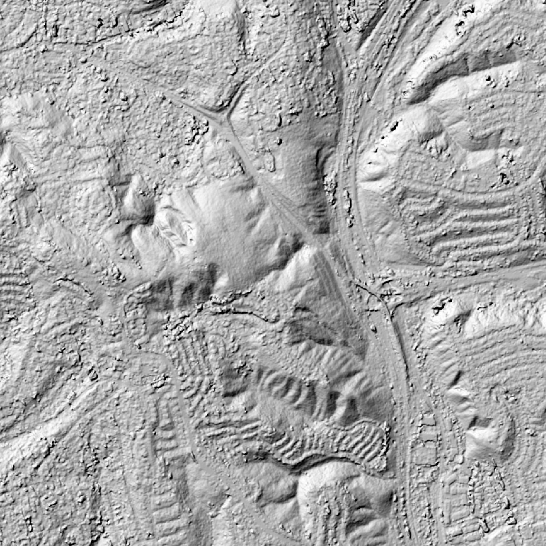

# CARS — WorldView-3, Mount Soledad

Compare DEMs produced by ASP and CARS on the same WorldView-3 stereo pair:

- **ASP** (NASA Ames Stereo Pipeline) — processed in [Tutorial 2](../tutorials/02_worldview_ucsd.ipynb)
- **[CARS](https://github.com/CNES/cars)** (CNES open-source stereo pipeline)

## About CARS

CARS is an open-source Python tool developed by CNES (French Space Agency) for producing {term}`DSMs <DSM>` from satellite stereo imagery. Key features:

- **Dense matching**: Uses [Pandora](https://github.com/CNES/Pandora) (Census cost + {term}`SGM <SGM / MGM>`) with multiple presets for urban, mountain, vegetation.
- **Multi-resolution**: Coarse-to-fine processing (default 16x → 4x → 1x) progressively narrows disparity search range.
- **Geometry**: Uses [Shareloc](https://github.com/CNES/shareloc) for {term}`RPC` handling — reads RPCs directly from GeoTIFF metadata.
- **Tiled architecture**: Processes data in tiles with configurable parallelism and per-worker memory limits.
- **No bundle adjustment** in the standard pipeline. Instead, CARS corrects epipolar grids using sparse SIFT tie points. Separate `cars-bundleadjustment` tool available as an optional extra.

## Source Data

The same WorldView-3 pair as the [SETSM comparison](setsm) and [Tutorial 2](../tutorials/02_worldview_ucsd.ipynb), as the tutorial prepares it: a 3 × 3 km window around the summit of Mount Soledad, cut from each image with `cam2rpc` and averaged to 1.2 m pixels (the native 0.31 m pixels, 4 × 4 at a time). Both images come from the IARPA CORE3D SpaceNet UCSD dataset.

| Catalog ID | Date | Off-nadir | Crop size |
|---|---|---|---|
| 104001000496A100 | 2014-11-09 | 1.1° | 2738 × 2805 px |
| 10400100071D8800 | 2015-01-24 | 16.3° | 2623 × 2645 px |

The pair's convergence angle is 16.8°. Each tool gets the same two crops and their RPC cameras, and writes a 2.4 m DEM, the tutorial's output grid. ASP's DEM is the tutorial's own, made from the orthorectified crops after bundle adjustment, as the notebook describes.

## Inputs

CARS reads the RPC from the crops' GeoTIFF tags (through [Shareloc](https://github.com/CNES/shareloc)), so the tutorial's crops go in as they are, with no camera file. The crops already cover the window, so the config gives no region of interest. (CARS 1.3.0 fails with `unsupported operand type(s) for /: 'list' and 'float'` when `roi` is set together with a single `resolution`; it keeps the resolution as a pair internally.)

## Running CARS via Docker

```bash
docker pull cnes/cars

docker run --platform linux/amd64 --rm --memory 11g --cpus 6 \
    -v /path/to/data/ucsd_soledad/crops:/input:ro \
    -v /path/to/output:/output \
    cnes/cars /output/config.yaml
```

:::{dropdown} Full configuration file (config.yaml)
:icon: file-code

```yaml
input:
  sensors:
    left:
      image: /input/104001000496A100_P001.tif
    right:
      image: /input/10400100071D8800_P001.tif

output:
  directory: /output/results
  resolution: 2.4
  epsg: 32611
  geoid: false

orchestrator:
  mode: multiprocessing
  nb_workers: 4
  max_ram_per_worker: 2000
```

Key parameters:
- `output.resolution: 2.4` — the tutorial's DEM grid
- `output.epsg: 32611` — UTM 11N, the tutorial's CRS
- `output.geoid: false` — heights above the ellipsoid, as ASP writes them (CARS's default is the EGM96 geoid)
- `orchestrator.nb_workers: 4`, `max_ram_per_worker: 2000` — four workers of 2 GB, for a 16 GB laptop whose Docker VM has 12 GB
:::

Expected outputs in `results/`:
- `dsm/dsm.tif` — DSM as GeoTIFF (float32)
- `dsm/image.tif` — Ortho-image
- `metadata.json` — Processing parameters and statistics

:::{dropdown} Notes on configuration
:icon: light-bulb

- **Matching preset**: Default is `census_sgm_default` (Census5, P1=8, P2=32). For urban areas, `census_sgm_urban` (Census11, P1=20, P2=80) may perform better.
- **Initial elevation**: Providing a coarse DEM via `input.initial_elevation.dem` narrows the disparity search range and speeds processing.
:::

## Run Metrics

| Metric | Value |
|---|---|
| Computation time | 7 min 38 s (Apple M-series laptop, amd64 emulation, 6 CPUs) |
| Docker `--memory` limit | 11 GB |
| Output DSM | 1410 × 1447 px (the crops' overlap), 2.4 m, EPSG:32611 |
| Convergence angle | 16.8° |

Two of the 68 rasterization tiles failed on CARS's second pass over them (`ERROR Pipeline will pursue without failed tiles` in the log); the DSM over the 3 km window is complete. The DSM's extreme values (down to −377 m) are blunders at the edge of the overlap, outside the window.

## Hillshade Comparison

CARS resolves the same hills, canyons, streets and blocks of houses as ASP, with sharper building edges, and fills the window with no voids where ASP has a few (0.8%, mostly at the freeway interchange and along building edges). Its surface is noisier in open ground, which shows as speckle in the hillshade, with some pits and mounds along building edges. Like SETSM, CARS uses the vendor RPCs as they are, so its DSM sits 9.5 m below ASP's (median difference); Tutorial 2's bundle adjustment ties the cameras to COP30 heights. Apart from that offset the two agree to 1.1 m (NMAD).

::::{grid} 2
:::{grid-item}

**ASP 2.4 m DEM**
<div class="fullres-btns">
  <a class="fullres-btn" href="../_images/soledad-asp-hillshade.png" target="_blank" rel="noopener noreferrer">Open at full resolution ↗</a>
</div>
:::
:::{grid-item}

**CARS 2.4 m DSM**
<div class="fullres-btns">
  <a class="fullres-btn" href="../_images/soledad-cars-hillshade.png" target="_blank" rel="noopener noreferrer">Open at full resolution ↗</a>
</div>
:::
::::

```{raw} html
<a href="https://maps.google.com/?ll=32.8396,-117.2413&z=15&t=k" target="_blank" rel="noopener noreferrer">View the comparison area in Google Maps</a>
```

## References

- [CARS repository](https://github.com/CNES/cars)
- [CARS documentation](https://cars.readthedocs.io)
- [CARS technical foundations](https://cars.readthedocs.io/en/stable/technical_foundations/index.html) — the concepts behind the pipeline
- [Pandora dense matching engine](https://github.com/CNES/Pandora)
- [Shareloc geometry library](https://github.com/CNES/shareloc)
