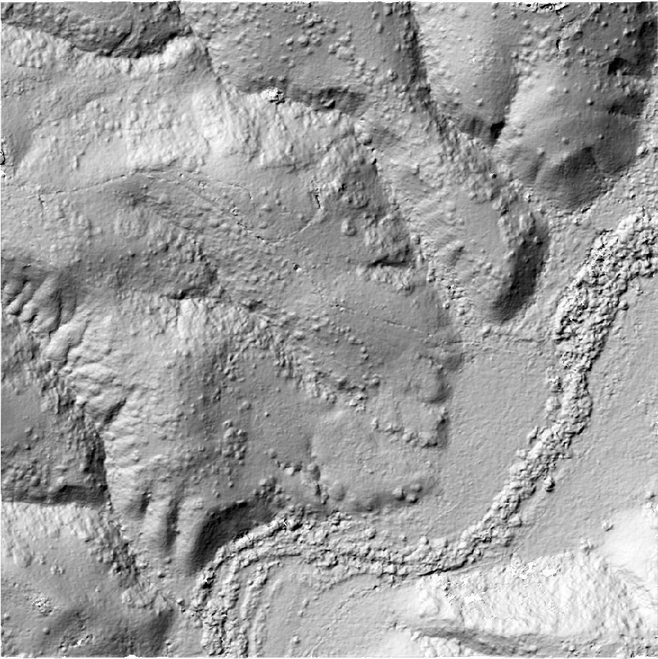
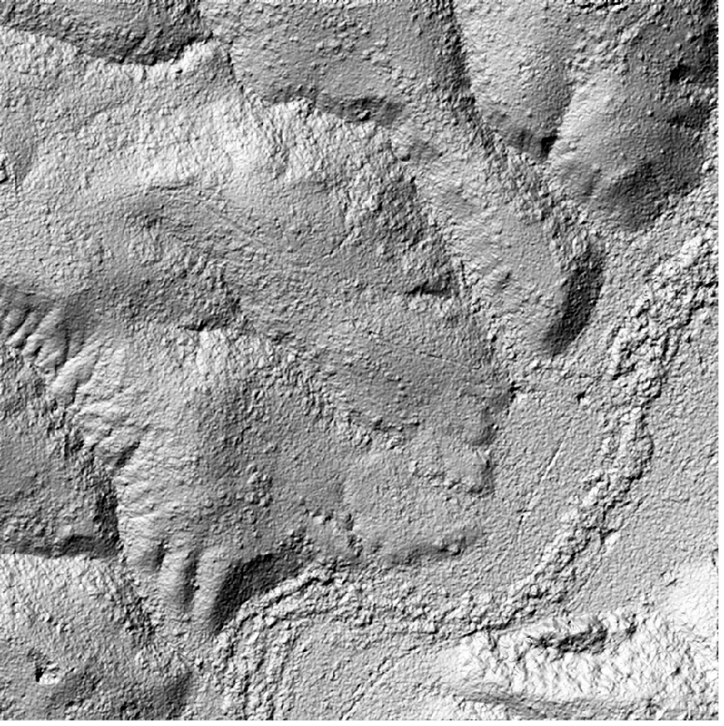

# SETSM — WorldView-3, Los Peñasquitos Canyon

Compare DEMs produced by two open-source stereo photogrammetry pipelines on the same WorldView-3 stereo pair:

- **ASP** (NASA Ames Stereo Pipeline) — processed in [Tutorial 2](../tutorials/02_worldview_ucsd.ipynb)
- **[SETSM](https://github.com/setsmdeveloper/SETSM)** (Surface Extraction with TIN-based Search-space Minimization) — Ohio State / Polar Geospatial Center

Both pipelines accept raw satellite imagery with {term}`RPC` camera models and produce gridded {term}`DSMs <DSM>`.

## Source Data

The same WorldView-3 pair as [Tutorial 2](../tutorials/02_worldview_ucsd.ipynb), over the tutorial's 1 km square at the west end of Los Peñasquitos Canyon (UTM 11N 480420–481420 E, 3641720–3642720 N). SETSM gets the two full scenes with their vendor camera files, and the square as its output boundary. Both images come from the IARPA CORE3D SpaceNet UCSD dataset.

| Catalog ID | Date | Off-nadir | Scene size |
|---|---|---|---|
| 104001000496A100 | 2014-11-09 | 1.1° | 43008 × 47104 px |
| 10400100071D8800 | 2015-01-24 | 16.3° | 43008 × 45056 px |

The pair's convergence angle is 16.8°. Both tools write a 1 m DEM, the tutorial's output grid. ASP's DEM is the tutorial's own, made from the square orthorectified out of the full scenes with the vendor cameras as they are, as the notebook describes.

## Approach

SETSM is open-source (Apache 2.0), pure C++ with no GPU requirement. We built and ran it via Docker to avoid host dependency conflicts.

SETSM reads `*.tif` images with a WorldView-style XML camera file of the same name next to each one, so the scenes are converted from NTF with the `gdal_translate` command in section 2.1.4 of its manual (ASP's `gdal_translate` has the JPEG2000 driver the NTFs need, in its `lib/` folder, found with `GDAL_DRIVER_PATH`), and the vendor XMLs are copied beside them. The `-boundary_*` flags limit the run to the square: SETSM reads and pyramids only the part of each scene it needs, so memory scales with the square, not the scenes.

Cutting the square out of each scene with `cam2rpc` first, as the CARS run does, does not work for SETSM: on those crops it matched only a few hundred points at its coarsest pyramid level and wrote noise (NMAD 37 m against the USGS 3DEP lidar), where the full scenes with the same boundary matched over 2,000 and gave the DEM below. SETSM reads more than the RPC from a camera file (the image corners, the pixel size, the RPC error terms), and a refitted RPC over a crop is not what it expects.

Also, note that SETSM's user manual warns against `-seed <filepath> <sigma>`: *"We caution that it is better to not use a seed DEM if possible, as it can only negatively impact the quality of the SETSM DEM."*

:::{dropdown} Docker build details
:icon: terminal

```bash
git clone https://github.com/setsmdeveloper/SETSM.git
cd SETSM

docker build --platform linux/amd64 -t setsm -f- . <<'DOCKERFILE'
FROM ubuntu:24.04 AS builder
RUN apt-get update && apt-get install -y --no-install-recommends \
    g++ make git \
    libgeotiff-dev libtiff-dev libproj-dev libjpeg-dev zlib1g-dev \
    && rm -rf /var/lib/apt/lists/*
COPY . /opt/SETSM
WORKDIR /opt/SETSM
RUN make INCS="-I/usr/include/geotiff"

FROM ubuntu:24.04
RUN apt-get update && apt-get install -y --no-install-recommends \
    libgeotiff5 libgomp1 libtiff6 libproj25 \
    && rm -rf /var/lib/apt/lists/*
COPY --from=builder /opt/SETSM/setsm /usr/local/bin/setsm
COPY --from=builder /opt/SETSM/default.txt /usr/local/share/setsm/default.txt
WORKDIR /data
ENTRYPOINT ["sh", "-c", "cp /usr/local/share/setsm/default.txt /data/default.txt 2>/dev/null; exec setsm \"$@\"", "--"]
DOCKERFILE
```

Multi-stage build — the final image contains only the `setsm` binary and runtime libraries. The `default.txt` config file is bundled and auto-copied at runtime (SETSM requires it in the working directory).
:::

## Run

```bash
docker run --platform linux/amd64 --rm --memory 11g --cpus 6 \
    -v /path/to/scenes:/data -w /data setsm \
    -image 104001000496A100_P001.tif -image 10400100071D8800_P001.tif \
    -outpath /data/results -outres 1 -mem 10 -minH -60 -maxH 150 \
    -boundary_min_X 480420 -boundary_min_Y 3641720 -boundary_max_X 481420 -boundary_max_Y 3642720 \
    -projection utm
```

`-minH`/`-maxH` span the square's heights (COP30 ranges from about −30 to 90 m here). `scripts/docs_figures/run_comparisons.sh` converts the scenes and runs this, and the CARS run.

| Metric | Value |
|---|---|
| Computation time | 3 min 29 s (Apple M-series laptop, amd64 emulation, 6 CPUs), after about 8 minutes converting the two scenes to TIFF |
| Peak memory (SETSM-reported) | 774 MB |
| Output DEM | 1000 × 1000 px (the square), 1 m, EPSG:32611 |
| Convergence angle | 16.8° |

### Hillshade Comparison

SETSM resolves the same spurs and gullies as ASP, with a smoother, more rounded surface that carries a grainy texture, where ASP's gullies and trails are sharper. It leaves a few more voids (1.7% of the square against ASP's 0.9%), in the trees along the creek and on the shadowed gully walls. Both tools use the vendor RPCs as they are, so the two DEMs sit at nearly the same height (SETSM 0.9 m above ASP, median difference) and agree to 0.6 m (NMAD) over the square; both sit about 10 m below ICESat-2, which Tutorial 2's report measures and removes.

::::{grid} 2
:::{grid-item}

**ASP 1 m DEM**
<div class="fullres-btns">
  <a class="fullres-btn" href="../_images/soledad-asp-hillshade.png" target="_blank" rel="noopener noreferrer">Open at full resolution ↗</a>
</div>
:::
:::{grid-item}

**SETSM 1 m DEM**
<div class="fullres-btns">
  <a class="fullres-btn" href="../_images/soledad-setsm-hillshade.png" target="_blank" rel="noopener noreferrer">Open at full resolution ↗</a>
</div>
:::
::::

```{raw} html
<a href="https://maps.google.com/?ll=32.918,-117.204&z=15&t=k" target="_blank" rel="noopener noreferrer">View the comparison area in Google Maps</a>
```

## References

- [SETSM repository](https://github.com/setsmdeveloper/SETSM)
- [SETSM user manual](https://github.com/setsmdeveloper/SETSM/blob/master/SETSM_User_manual.pdf)
- Noh & Howat (2015), "Automated stereo-photogrammetric DEM generation at high latitudes: Surface Extraction with TIN-based Search-space Minimization (SETSM) validation and demonstration over glaciated regions", *GIScience & Remote Sensing*, 52(2), 198-217.
