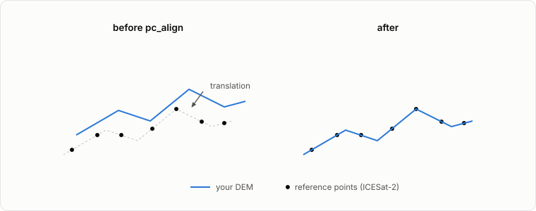
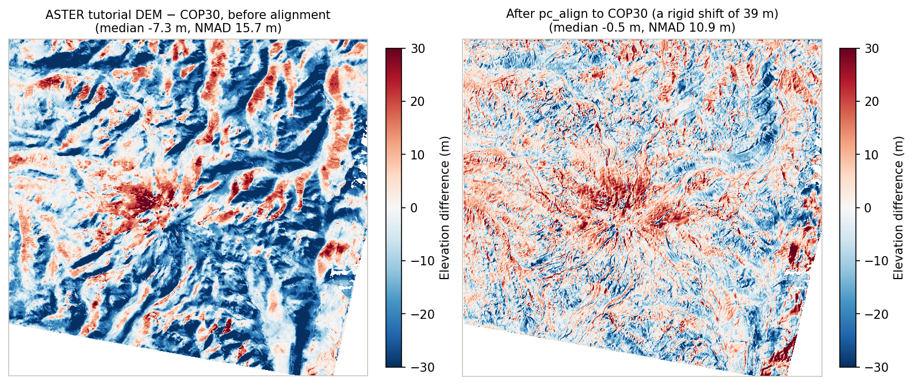

# Alignment

Even a clean stereo DEM usually sits slightly off true ground, because small camera-model errors translate into a shift of the whole surface. `pc_align` removes that shift by registering the DEM to a trusted reference.

## The reference dataset

ICESat-2 {term}`ATL06-SR` for Earth, {term}`MOLA` for Mars, {term}`LOLA` for the Moon, or any prior high-quality DEM (3DEP, ArcticDEM, regional lidar). A good reference does not need to be dense; it needs to be accurate and to sample stable terrain. A few thousand well-placed altimetry points constrain a rigid shift better than a dense but biased DEM.

## What `pc_align` does

The algorithm is iterative closest point ({term}`ICP`): pair each point of your DEM with the nearest reference point, find the rigid transformation (rotation and translation; a translation-only or scale-solving variant if you ask for one) that minimizes those distances, apply it, and repeat until the fit stops improving. The output is your DEM moved onto the reference.



## When it helps and when it doesn't

`pc_align` fixes what a rigid move can fix: near-uniform bias and small global tilt. It cannot fix localized blunders, matching noise, or non-rigid warp; those need attention upstream (better bundle adjustment, better stereo parameters, or better input imagery). The difference maps below show both, for the ASTER tutorial's DEM against its COP30 reference, before and after aligning it to COP30 with `pc_align`:



Before alignment, the difference follows the slopes: positive on slopes facing one way and negative on those facing the other, which is what a horizontal offset looks like. A rigid shift of 39 m removes that pattern and the median offset (−7.3 m to −0.5 m). What remains, such as the higher heights around the summit, is not a rigid offset; it is probably snow and ice that changed between the two datasets' dates, and alignment cannot remove it. The tutorial's own report aligns this DEM to ICESat-2 points instead, which gives a different, smaller shift (15 m): the result depends on the reference.

If the difference map against the reference still shows structure after alignment, the problem is not alignment.

## Reading the alignment report

`pc_align` prints percentile breakdowns of the point-to-reference distances before and after alignment, plus the transformation it applied. From the ASTER tutorial's report, which aligns its DEM to {term}`ICESat-2` points:

```text
Input:  error percentile of smallest errors (meters): 16%: 2.33428, 50%: 8.00829, 84%: 15.6824
Output: error percentile of smallest errors (meters): 16%: 2.07483, 50%: 7.07163, 84%: 13.6993
Translation vector (North-East-Down, meters): Vector3(5.9170475,-13.31291,3.1383536)
Translation vector magnitude (meters): 14.902828
```

Three things to check:

- The 50% lines are the main metric: the median point-to-reference distance dropped from 8.0 m to 7.1 m. The drop is modest because much of the remaining distance is not a rigid offset: the summit's snow and ice changed between the dates, and 15 m ASTER pixels blur the steep terrain.
- The translation vector says where the DEM moved: here 6 m north, 13 m west and 3 m down, 15 m in all. It should be a plausible magnitude for your sensor: tens of meters for ASTER's 15 m pixels, meters for WorldView.
- A median that barely drops, or a huge translation, means the DEM and reference disagree in a way ICP cannot reconcile; check the vertical datums and the overlap area first.

## Alignment inside `asp-plot`

The `asp_report` command runs `pc_align` by default (`--no-pc-align` turns it off, and `--no-altimetry` skips it too) against the appropriate altimetry reference for the body (ICESat-2 for Earth, MOLA for Mars, LOLA for the Moon) and appends alignment-report pages to the PDF. This is how the ASTER tutorial aligns its DEM: its report command runs `pc_align` without any extra flag. It wants at least 500 reference points on the DEM by default; the WorldView tutorials' 1.2 × 1 km area holds about 280 ICESat-2 points, so their reports pass `--pc-align-min-points 150`, and their profiles show the DEM before and after the 10 m shift onto the points.

## Where to read more

- [ASP pc_align docs](https://stereopipeline.readthedocs.io/en/latest/tools/pc_align.html)
