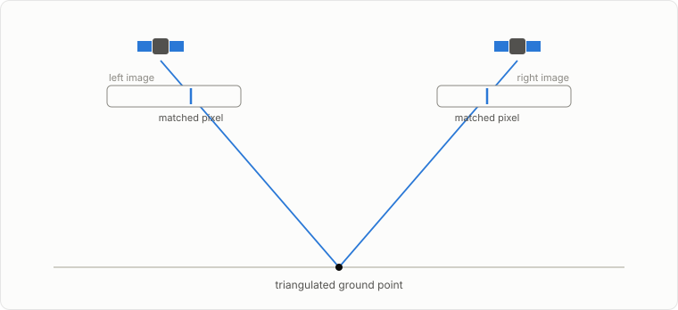
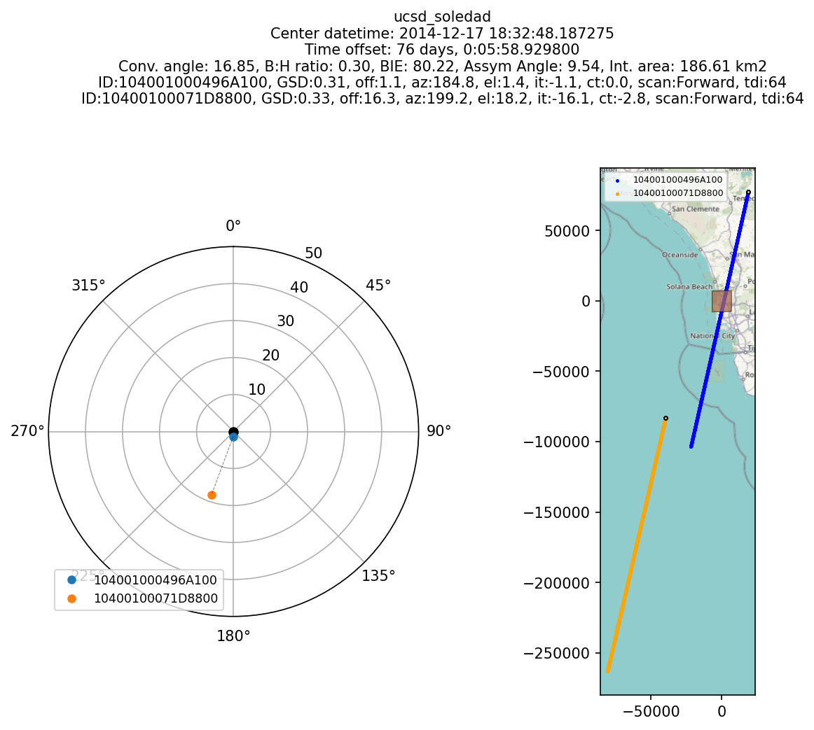
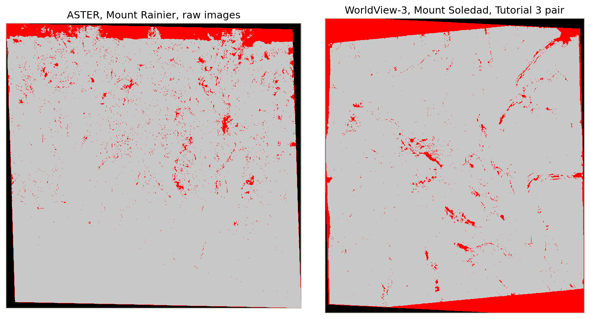

# Stereo photogrammetry

Two views of the same patch of ground from different angles produce {term}`parallax`: a pixel shift between images that encodes ground height.

## What ASP computes

For every pixel in the left image, `parallel_stereo` searches the right image for the best-matching pixel. The result is a {term}`disparity map`: a per-pixel shift between the two images. ASP computes it in stages, writing each to disk: an initial whole-pixel disparity (`run-D.tif`), a subpixel refinement (`run-RD.tif`), and a filtered final version (`run-F.tif`). Triangulation then combines each matched pair with the {term}`camera models <camera model>`: the two viewing rays are intersected in space, and the intersection is a 3D ground point.

The triangulated points land in a {term}`point cloud` (`run-PC.tif`), which `point2dem` grids into a DEM. See [Pipeline overview](pipeline-overview.md) for where this sits in the full flow.

## Camera models

Triangulation works because each camera model can turn a pixel into a viewing ray. A camera model is the mapping between image pixels and ground coordinates; it encodes where the satellite was, how it was oriented, and how its optics project the scene onto the detector. Orbital imagers are push-broom sensors that acquire one image row at a time as the satellite moves, so position and orientation are functions of time across the image.

Vendors describe that geometry in two main forms. {term}`RPC` replaces the vendor's rigorous physical model with fitted ratios of polynomials that map longitude, latitude, and height to the matching pixel. The coefficients are compact, sensor-agnostic, and fast to evaluate, and they keep the physical details (orbit, pointing, optics) private; the tradeoff is that the model is a black box that can only report where a ground point lands in the image. Most commercial Earth imagery ships with RPC. The WorldView XMLs in this guide carry both an exact linescan model and an RPC fit; ASP detects the exact one and uses it by default.

The Community Sensor Model ({term}`CSM`) is a community standard interface for rigorous models rather than an approximation. ASP ships the open USGS implementation ([usgscsm](https://github.com/DOI-USGS/usgscsm)), whose state files spell out the sensor's trajectory, orientation over time, and optics. Because those physical parameters are exposed, ASP can adjust them; that is what makes {term}`jitter` correction possible, and `jitter_solve` works only with CSM cameras.

## Matcher and subpixel mode

The matcher (`--stereo-algorithm`) and the subpixel refiner (`--subpixel-mode`) are the two settings that most affect quality and runtime.

- `asp_bm`, ASP's classic block matcher, is fast and works well on well-textured images, which makes it a good choice for a quick first look. Pair it with `--subpixel-mode 1` (fast) or `2` (slower, more accurate).
- `asp_mgm` adds a smoothness constraint across neighboring pixels, so it does better where texture is poor or repetitive, at more compute and memory. Pair it with `--subpixel-mode 9`, which works only with `asp_mgm` and `asp_sgm`.
- The time and memory `asp_mgm` needs grow with the range it searches, so orthorectify the images first (see [Orthorectification](orthorectification.md)) to keep that range small.

The tutorials use `asp_mgm` with `--subpixel-mode 9` throughout. The [ASP correlation docs](https://stereopipeline.readthedocs.io/en/latest/correlation.html) describe all the options.

## Viewing geometry

Height precision is determined by the viewing geometry before any processing runs: the {term}`convergence angle` (the angle between the two viewing rays) and the {term}`base-to-height ratio <base-to-height ratio (B/H)>`. Too little convergence and the rays intersect at a shallow angle, so small matching errors become large height errors; too much and the two images look so different that matching degrades.

Both quantities come from the vendor metadata. `asp_plot.stereo_geometry.StereoGeometryPlotter` reads the camera XMLs and plots them, as run in [the WorldView tutorial](../tutorials/02_worldview_ucsd.ipynb) for its stereo pair:

The skyplot (left) shows where each satellite sat in the sky when it imaged the ground; the map (right) shows the ground tracks and the shared footprint. The header lists the derived quantities, including the convergence angle and base-to-height ratio.

## Where matching fails

Featureless surfaces (open water, fresh snow, sand), repetitive texture, occlusion (one camera sees a slope face the other cannot), clouds, and illumination differences between acquisitions all break the matcher. Failures show up as red in `run-GoodPixelMap.tif` (successful matches are gray) and as voids in the DEM. The maps below are from two runs on images that were not orthorectified first: the ASTER tutorial's pair, and the WorldView pair from the blending tutorial with the most failures. At Rainier the failures are on the snow-covered summit and in the steep, dark terrain north of it; at Mount Soledad they are mostly on shadowed slopes. Red along the edges is mostly where the two images don't overlap.

Voids in reasonable places are normal; voids everywhere usually mean a geometry or preprocessing problem, not a matching problem.

## Where to read more

- [ASP stereo correlation docs](https://stereopipeline.readthedocs.io/en/latest/correlation.html)
- [ASP triangulation docs](https://stereopipeline.readthedocs.io/en/latest/tools/parallel_stereo.html)
- [ASP RPC docs](https://stereopipeline.readthedocs.io/en/latest/examples/rpc.html) and [ASP CSM docs](https://stereopipeline.readthedocs.io/en/latest/examples/csm.html)
