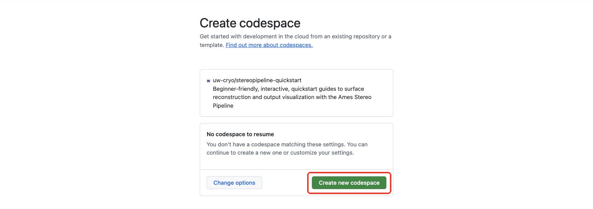
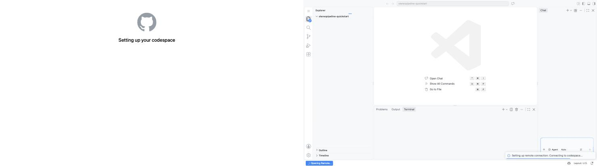
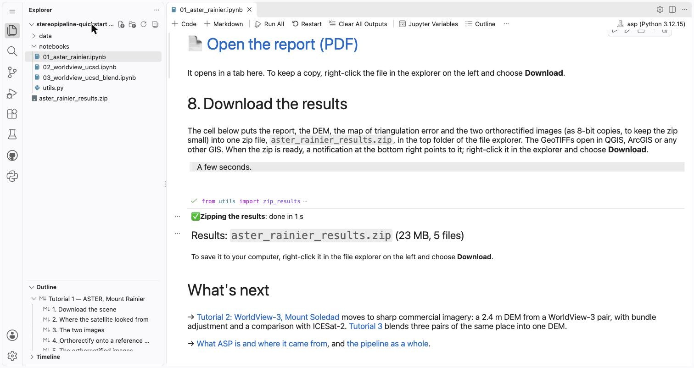

# Make a 3D map from satellite images

```{raw} html
<style>
/* This page only: larger type and roomier steps for a first-time reader. */
article.bd-article { font-size: 1.2rem; line-height: 1.6; }
article.bd-article h2 { font-size: 1.9rem; margin-top: 2.2rem; }
article.bd-article .sd-btn { font-size: 1.35rem; padding: 0.8em 1.2em; }
article.bd-article img {
  border: 1px solid var(--pst-color-border, #ccc);
  border-radius: 6px;
  box-shadow: 0 2px 8px rgba(0, 0, 0, 0.12);
  margin: 0.8em 0 1.2em;
}
</style>
```

In about 10 minutes, in your browser, with nothing to install. This guide runs the [NASA Ames Stereo Pipeline (ASP)](https://stereopipeline.readthedocs.io/) on real satellite images and shows you the result: a 3D model of the terrain (a DEM) and a PDF report.

## 1. Sign in to GitHub

You need a free GitHub account. If you don't have one, [create one](https://github.com/signup), then sign in.

## 2. Click the button

```{button-link} https://codespaces.new/uw-cryo/stereopipeline-quickstart?quickstart=1
:color: primary
:expand:
Open in GitHub Codespaces
```

A GitHub page opens with a green **Create new codespace** button. Click it.



GitHub then builds a workspace for you with everything installed: a page says "Setting up your codespace", and then VS Code appears in your browser with a message at the bottom right while it connects. **Nothing asks you to do anything for between 30 seconds and a minute.**



## 3. Click "Trust Folder & Continue"

A box asks "Do you trust the authors of the files in this folder?". Every new workspace asks this once. Click **Trust Folder & Continue**.


## 4. Watch Tutorial 1 run

Tutorial 1 opens within a few seconds and, **between 30 seconds and a minute later**, starts running by itself. You don't have to click anything.


1. The file explorer: `notebooks/` holds the three tutorials, and `data/` fills with the images and results.
2. The tutorial itself: each step has a short explanation and how long it takes.
3. The step that is running: its code (shown as one line; click it to see it all), the command, the last lines of its output and the time so far. When it finishes, its figures appear with a caption. **Scroll down to follow it.**

What to expect:

- **About 10 minutes in all, sometimes 15.** The longest step, matching the two images, takes most of it and fills in a map of the mountain as it goes.
- **A pop-up may say "High codespace CPU (100%) utilization detected"** while the images are matched. That's expected (stereo uses every core); close it.
- **When it's done,** the end of the notebook shows figures from the report and a large link to open the PDF; a notification at the bottom right says the results zip is ready, and the zip appears at the top of the file explorer.



1. The link that opens the PDF report.
2. The last step's result line: the zip's name and size.
3. The zip itself, at the top of the file explorer: right-click it and choose **Download**.

If nothing has started after a couple of minutes, or to run it again later, click **Run All** in the toolbar at the top of the notebook:


## 5. Then

- **Tutorials 2 and 3** use sharper WorldView-3 images of a hill in San Diego. They don't start by themselves: open one from the explorer and click **Run All**, the button shown above. [About the tutorials](tutorials/index.md).
- **What just happened?** [What ASP is](start/what-is-asp.md) and [the pipeline, step by step](concepts/pipeline-overview.md).
- **Your results:** the last step of each tutorial puts them in one zip file to download and open in QGIS or ArcGIS.
- **Your workspace** stays as you left it. GitHub stops it after half an hour of inactivity and deletes it after 30 days; the free monthly hours and other details are on [the Codespaces page](start/codespaces.md).

## More

- [Tutorials](tutorials/index.md): the three notebooks, with their outputs.
- [What ASP is](start/what-is-asp.md) and the concept pages: [the pipeline](concepts/pipeline-overview.md), [stereo photogrammetry](concepts/stereo-photogrammetry.md), [bundle adjustment](concepts/bundle-adjustment.md), [orthorectification](concepts/orthorectification.md), [alignment](concepts/alignment.md), [visualization with `asp-plot`](concepts/visualization.md).
- [Other open-source stereo pipelines](comparisons/index.md): the same images through SETSM and CARS.
- Reference: [glossary](reference/glossary.md), [ASP output files](reference/output-files.md), [local install](reference/installation.md), [data sources and licences](reference/data.md), [further reading](reference/further-reading.md).

This guide covers one straightforward path through ASP, which has hundreds of options for dozens of sensors; the [official ASP documentation](https://stereopipeline.readthedocs.io/) is the reference.

## Reporting problems

For anything broken, wrong or unclear, [open a problem report](https://github.com/uw-cryo/stereopipeline-quickstart/issues/new?template=problem-report.yml); the form asks for the few details needed to follow up. Questions about ASP itself belong on the [ASP support forum](https://groups.google.com/g/ames-stereo-pipeline-support).

```{toctree}
:maxdepth: 2
:caption: Get started
:hidden:

start/what-is-asp
start/codespaces
```

```{toctree}
:maxdepth: 2
:caption: Concepts
:hidden:

concepts/pipeline-overview
concepts/stereo-photogrammetry
concepts/bundle-adjustment
concepts/orthorectification
concepts/alignment
concepts/visualization
```

```{toctree}
:maxdepth: 2
:caption: Tutorials
:hidden:

tutorials/index
tutorials/01_aster_rainier
tutorials/02_worldview_ucsd
tutorials/03_worldview_ucsd_blend
```

```{toctree}
:maxdepth: 2
:caption: Comparisons
:hidden:

comparisons/index
```

```{toctree}
:maxdepth: 2
:caption: Reference
:hidden:

reference/glossary
reference/output-files
reference/installation
reference/data
reference/further-reading
```
