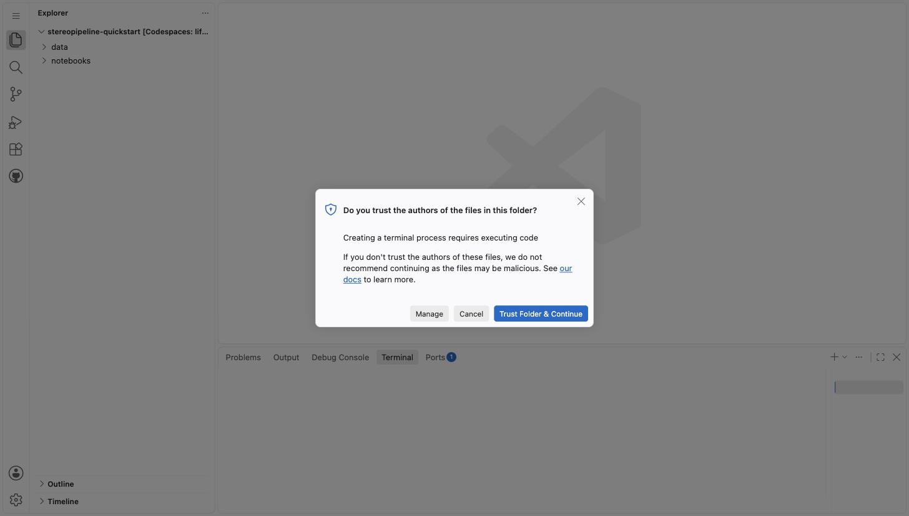
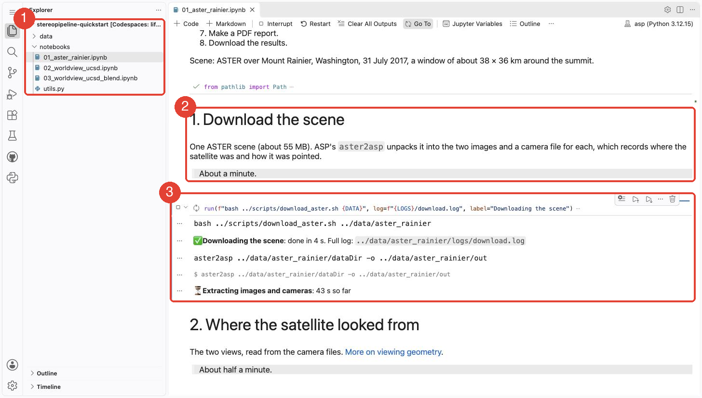
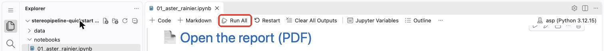

# Codespaces: machine size, costs and storage

The tutorials run in [GitHub Codespaces](https://docs.github.com/en/codespaces): a Linux machine with VS Code in your browser, which starts with ASP and [`asp-plot`](https://asp-plot.readthedocs.io/en/latest/) already installed. You need a free [GitHub account](https://github.com/signup) and nothing else. [The home page](../index.md) walks through the launch with a screenshot of every click; this page has the short version and the details.

## Launch

```{button-link} https://codespaces.new/uw-cryo/stereopipeline-quickstart?quickstart=1
:color: primary
Open in GitHub Codespaces
```

1. Sign in to GitHub, click the button, then the green **Create new codespace** button on the page that opens. If you have used it before, the page offers to resume your previous Codespace instead: **Resume this codespace** picks up where you left off (click **Run All** to run a tutorial again), and **Create a new one** starts fresh, after an options page where you click **Create codespace**.
2. Wait between 30 seconds and a minute: a page says "Setting up your codespace", then VS Code appears in your browser while it connects.
3. A box asks "Do you trust the authors of the files in this folder?". Every new Codespace asks this once. Click **Trust Folder & Continue**.

   

4. Tutorial 1 opens within a few seconds and, between 30 seconds and a minute later, starts running by itself. Scroll down to follow it: (1) the file explorer, (2) each step's text, (3) the step that is running, with its command, the last lines of its output and the time so far.

   

The whole of Tutorial 1 takes about 10 minutes, sometimes 15. The repo's **Code → Codespaces** tab also creates a Codespace; the "Create codespace with options" entry there lets you pick a larger machine.

## Machine size

The default machine is 4-core, 16 GB of memory, 32 GB of disk, which every GitHub account can launch. The run times in the tutorials are for it. Larger machines run stereo matching faster, since it uses every core, and are billed at higher rates ([Codespaces pricing](https://docs.github.com/en/billing/managing-billing-for-github-codespaces/about-billing-for-github-codespaces)).

```{tip}
On a machine with more than 4 cores, raise `--processes` in the `parallel_stereo` commands (and `--threads` in `bundle_adjust` and `mapproject`) to match.
```

## Running the tutorials

| Notebook | What it makes | Time |
|---|---|---|
| `01_aster_rainier.ipynb` | A 30 m DEM of Mount Rainier from two ASTER images, and a PDF report | about 10 min |
| `02_worldview_ucsd.ipynb` | A 2.4 m DEM of Mount Soledad from a WorldView-3 pair, compared with ICESat-2 | about 10 min |
| `03_worldview_ucsd_blend.ipynb` | Three WorldView-3 pairs of the same window, blended into one DEM | about 16 min more |

Tutorial 1 starts by itself the first time a new Codespace opens. For the others, or if Tutorial 1 hasn't started after a couple of minutes, open the notebook from the explorer and click **Run All** in the toolbar at the top, then scroll down to follow it. The code cells are shown as one line; click one to see its code.



While a step runs, its cell shows the command, the last few lines of its output and the time so far; ASP's full output goes to a log file in `data/<dataset>/logs/`. During stereo matching, a pop-up may say "High codespace CPU (100%) utilization detected": that's expected, since stereo uses every core. Close it.

If a step fails, the cell shows the end of its log. [Open a problem report](https://github.com/uw-cryo/stereopipeline-quickstart/issues/new?template=problem-report.yml) with it.

## Storage and persistence

- The files in your Codespace stay as long as the Codespace exists. GitHub stops it after 30 minutes without activity (your files are kept) and deletes it after 30 days without use.
- To keep results, download them: the last step of each tutorial zips them for you, and any file can be downloaded from the explorer with a right-click and **Download**. The first time you right-click there, your browser may ask whether the page can see your clipboard; **Allow** or **Block**, either works.
- The `data/` folder holds the images and results and can grow to a few GB. It is not under version control.

## Costs

GitHub gives every personal account a monthly Codespaces allowance for free; see the [Codespaces billing page](https://docs.github.com/en/billing/managing-billing-for-github-codespaces/about-billing-for-github-codespaces) for the current numbers. Stopping a Codespace stops the hours; deleting it frees the storage. Both are on the repo's **Code → Codespaces** tab and at [github.com/codespaces](https://github.com/codespaces).

```{tip}
Students and educators with a `.edu` email get a larger allowance through the [GitHub Student Developer Pack](https://education.github.com/pack) or [GitHub for Teachers](https://education.github.com/teachers).
```

If you'd rather not use Codespaces, see [the local install guide](../reference/installation.md).
